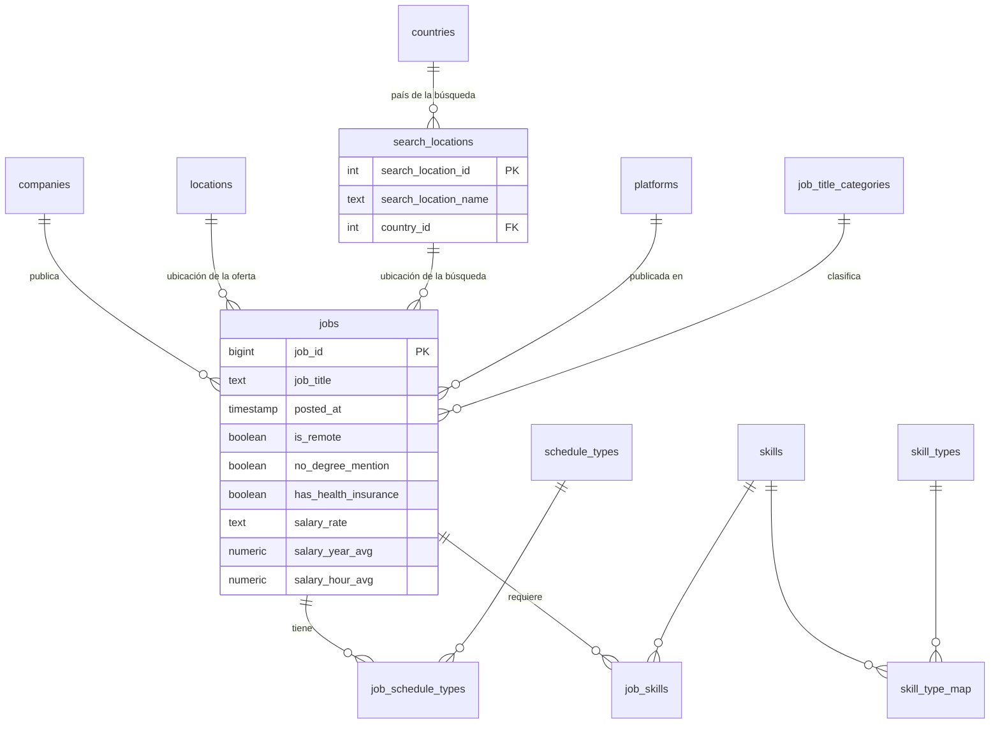

# Pipeline de ofertas de empleo: CSV → PostgreSQL → modelo 3NF

Pipeline en **Python + SQL** que carga `data_jobs.csv` (785.741 ofertas de empleo de 2023) en PostgreSQL y lo transforma en un modelo relacional normalizado en tercera forma normal.

```
data_jobs.csv ──► parseo, tipado y validación ──► raw_jobs ──► SQL ──► modelo 3NF
                  (pandas + Pandera)              (TEXT[] / JSONB)   (13 tablas)
```

## Ejecución

Requisitos: Docker Desktop, Python 3.10 o superior y Git.

```bash
git clone https://github.com/jagarciaal95/challenge_data_engineer.git
cd challenge_data_engineer

python -m venv .venv
# Windows (PowerShell): .venv\Scripts\Activate.ps1
# macOS / Linux:        source .venv/bin/activate
pip install -r requirements.txt

cp .env.example .env          # y cambia la contraseña
# copia data_jobs.csv a la carpeta data/ (el CSV no se versiona)

docker compose up -d          # PostgreSQL 16
python -m pipeline.main all   # ingesta + transformación
```

Comandos disponibles:

| Comando | Qué hace |
|---|---|
| `python -m pipeline.main ingest` | CSV → `raw_jobs` |
| `python -m pipeline.main transform` | `raw_jobs` → modelo 3NF |
| `python -m pipeline.main all` | Ambos pasos |

Opciones de `ingest` y `all`: `--csv RUTA`, `--chunksize N` y `--nrows N` (limita filas, útil para pruebas rápidas).

El pipeline es **idempotente**: cada ejecución reconstruye el mismo estado sin duplicar datos. La transformación completa tarda unos 6 minutos.

## Tests

```bash
python -m pytest -v
```

Son 32 pruebas unitarias sobre el parseo de listas, diccionarios y booleanos (`parsing.py`), el tipado de cada bloque (`clean.py`) y las reglas de validación (`validate.py`). Incluyen casos límite: valores vacíos, `NaN`, textos mal formados y un intento de inyección de código que `ast.literal_eval` rechaza.

## Estructura

```
sql/raw_jobs.sql          tabla de aterrizaje
sql/schema.sql            DDL del modelo 3NF
sql/transform_3nf.sql     raw_jobs -> 3NF
pipeline/                 config, parsing, clean, validate, ingest, transform, main
tests/                    pruebas unitarias
```

## Modelo 3NF



El DDL completo está en [`sql/schema.sql`](sql/schema.sql).

## Decisiones de diseño

Cada decisión parte de una consulta de exploración sobre los datos reales.

### Herramientas

- **Python para la ingesta, SQL para la transformación.** Python es lo adecuado para lo que SQL hace mal (parsear `"['python', 'sql']"` y validar). La normalización es una operación de conjuntos, donde SQL es más claro y rápido. Se descartó dbt para mantener el entorno simple.
- **PostgreSQL con Docker Compose.** Los tipos nativos `TEXT[]` y `JSONB`, y funciones como `unnest` y `jsonb_each`, simplifican el trabajo con columnas semi-estructuradas.
- **Credenciales solo por variables de entorno.** `.env` está en `.gitignore`, y el código falla con un mensaje claro si falta alguna variable.

### Ingesta

- **Dos capas.** `raw_jobs` conserva los datos como llegan, ya tipados, y permite repetir la transformación sin releer el CSV.
- **`ast.literal_eval` en lugar de `json.loads`.** Las listas y diccionarios usan comillas simples (sintaxis de Python), así que no son JSON válido.
- **Lectura por bloques y `COPY`.** El CSV pesa unos 230 MB. Procesar 50.000 filas cada vez mantiene la memoria baja, y `COPY` es mucho más rápido que insertar fila por fila.
- **Validación con Pandera antes de cargar** y una sola transacción: si algo falla, no queda una carga parcial.
- **Hallazgo al cargar el archivo completo.** Una oferta (de 785.741) no tiene `job_title`. En `raw_jobs` se conserva, con un aviso en el log, porque esa capa refleja la fuente. La capa 3NF la excluye, porque `jobs.job_title` es obligatorio.

### Modelo 3NF

**1. Duplicados.** El CSV no trae un identificador. Hay 775 filas sobrantes (0,1 %) con el mismo título, empresa, ubicación, plataforma y fecha, repartidas en 707 grupos. Ninguno difiere en la búsqueda, pero en 488 grupos las skills no coinciden. Se deduplica por esa clave, conservando el `raw_id` más bajo (determinista). La alternativa, unir las skills de los duplicados, se descartó por complejidad frente al impacto (0,1 %). `jobs` queda con 784.965 filas.

**2. El país depende de la búsqueda, no de la ubicación de la oferta.** 1.167 ubicaciones aparecen con más de un país (por ejemplo `New York, NY` con `Sudan` y con `United States`), pero **ninguna `search_location` tiene más de un `job_country`**. Todas las ofertas con país `Sudan` vienen de la búsqueda `Sudan`, y se reparten en 1.434 ubicaciones distintas. Es decir, `job_country` describe el país de la búsqueda, no del lugar de la oferta, lo cual contradice la descripción del diccionario de datos. Guardar el país en `jobs` crearía una dependencia transitiva (`job_id → search_location → country`), así que vive en `search_locations`. Por qué una búsqueda en "Sudan" devuelve ofertas de EE. UU. es algo que no he podido determinar.

**3. Horarios: valores atómicos.** Los 47 valores de `job_schedule_type` son combinaciones de 7 valores simples ("Full-time, Part-time, and Internship"), a veces con distinto orden. Un campo con varios valores viola la primera forma normal, así que se parte en `schedule_types` (7 filas) y la tabla puente `job_schedule_types`. Dos valores en otro idioma ("Pekerjaan tetap" y "Kontraktor", 62 filas) se unifican como `Full-time` y `Contractor`. **Es un supuesto mío.**

**4. Skills: dos relaciones muchos a muchos.**
- `job_skills` resuelve oferta ↔ skill (3.591.379 filas).
- `skill_type_map` resuelve skill ↔ categoría. 4 de las 252 skills pertenecen a más de una categoría (`firebase`, `mongodb`, `ruby`, `sas`), así que la categoría no es un atributo de la skill.

**5. Plataformas.** El prefijo `via ` aparece en todas las filas menos en 64, y se elimina. Quedan 7.903 plataformas, que incluyen variantes del mismo sitio (por ejemplo "Trabajo.org" y "Jobs Trabajo.org"). No se unificaron a mano, porque sería una lista de reglas arbitrarias.

**6. Nulos.** Las claves foráneas de `jobs` admiten `NULL`, salvo el título. Se conservan como `NULL` los vacíos reales de la fuente (1.045 ofertas sin ubicación, 12.667 sin horario...), en vez de rellenarlos con valores como "Unknown".

**7. Claves.** Todas las dimensiones usan clave sustituta (`IDENTITY`) con `UNIQUE` sobre el nombre. `jobs.job_id` coincide con `raw_id`, para poder rastrear cada oferta hasta su fila original.

### Salarios

Solo el 4 % de las ofertas publica salario. `salary_rate = year` rellena únicamente `salary_year_avg`, y `hour` únicamente `salary_hour_avg`. Las 401 ofertas con salario mensual, semanal o diario no tienen ningún monto utilizable en las columnas calculadas, así que no se puede convertir: quedan sin salario, y `salary_rate` se conserva para poder identificarlas.

## Limitaciones conocidas

- **8 búsquedas quedan sin país** (48 ofertas): Sierra Leone, Gabon, Saint Lucia, Western Sahara, Grenada, Saint Vincent and the Grenadines, Antigua and Barbuda y Vanuatu. La fuente deja `job_country` vacío para ellas. No se rellenó con inferencias.
- **Variantes de empresa y plataforma** (mayúsculas, sufijos, sitios con varios nombres) no se unifican.
- **La transformación tarda unos 6 minutos**, sobre todo por el `unnest` de 3,5 millones de skills.
- **No hay tests de integración contra PostgreSQL**, solo unitarios de Python.

## Diseño conceptual OLAP (modelo en estrella)

*(Sección conceptual: no está implementada.)*

**Tabla de hechos: `fact_job_posting`.** Granularidad: **una fila por oferta de empleo** (un `job_id`). Contiene las claves de las dimensiones, las medidas y `job_id` como dimensión degenerada.

**Dimensiones principales**
- `dim_date`: fecha de publicación (día, mes, trimestre, año, día de la semana).
- `dim_company`.
- `dim_location`: ubicación de la oferta.
- `dim_search_location`: ubicación de la búsqueda, con su país desnormalizado. Se usa como rol aparte, porque en este modelo el país depende de la búsqueda.
- `dim_platform`.
- `dim_job_title`: categoría estandarizada y título original.
- `dim_job_flags`: junk dimension (ver abajo).

**Medidas**
- `salary_year_avg` y `salary_hour_avg`: no aditivas, se resumen con promedio, mínimo, máximo o percentiles.
- `job_count` (valor 1): aditiva, permite contar ofertas con `SUM`.
- `skill_count`: número de skills de la oferta.
- `has_salary` (0/1): permite calcular el porcentaje de ofertas con salario publicado.

**Reto 1: skills con una tabla puente.** Una oferta tiene varias skills y una skill aparece en muchas ofertas. Meterlas en la tabla de hechos cambiaría su granularidad. Se crea `dim_skill` (con su categoría) y `bridge_job_skill(job_key, skill_key, weighting_factor)`. El factor de ponderación (1 / número de skills de la oferta) permite sumar medidas a través del puente sin contar el mismo salario varias veces al agrupar por skill. Los horarios (muchos a muchos igualmente) se tratarían del mismo modo con un `bridge_job_schedule`.

**Reto 2: indicadores booleanos con una junk dimension.** `is_remote`, `no_degree_mention` y `has_health_insurance` son indicadores de baja cardinalidad. Dejarlos como columnas sueltas en la tabla de hechos, o crear una dimensión por cada uno, ensucia el modelo. Se agrupan en `dim_job_flags`, con todas las combinaciones posibles (2³ = 8 filas, más las combinaciones con valores nulos si se quieren conservar) y una descripción legible. La tabla de hechos guarda una sola clave, `flags_key`.